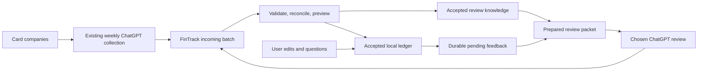

# Ledger, weekly intake, feedback, and review knowledge

2026-10-24. Original architecture proposal, subsequently implemented at the user's
request. Current source replaces routine selected-range export with automatic
pending-work/full-history packets, staged results/weekly intake, explicit proposals
and receipts, editable guidance, automatic iCloud folder backup, and full restore.
All 83 portable tests pass; Apple build, V3 migration, and cloud/device behavior
await validation. See [current guide](chatgpt-export.md), [hardening](hardening.md),
and [combined acceptance](ipad-acceptance.md). The design rationale below remains;
its initial-state table is historical, not the present implementation status.

Latest UX/contracts: [review-flow.md](review-flow.md) supersedes generic per-proposal
acceptance for discussion replies. Only actual value edits require a decision;
import records matching acknowledgements, while replies/closure/drafts stay
durable and backup-eligible. Prepared files are explicitly frozen by review mode.

## Confirmed workflow

- The user reports that their existing ChatGPT workflow connects directly to
  their credit-card companies and retrieves transactions once per week. FinTrack
  has not inspected those connections, the task, its output, or its reliability.
  No bank or ChatGPT account access is implied by this statement.
- The user wants the outgoing review to mean "what we need to discuss based on
  what I marked, added, or modified," without repeatedly choosing records/context.
- The user accepts manual attachment initially if FinTrack prepares the contents
  automatically. This does not authorize cloud sync or a hosted bridge.
- FinTrack remains usable offline; the user's ChatGPT Plus session performs the
  analysis. No separately billed LLM API or automatic paid fallback is introduced.
- The user requires periodic review of the full accepted history to refine
  classification decisions, in addition to routine pending-work packets.
- The user requires the main database to stay backed up to the cloud. Eligibility
  for periodic device backup and manual archive export alone do not meet that
  stronger expectation. Automatic backup/retry/status needs a concrete design;
  zero-delay cloud protection cannot be guaranteed while offline.
- Automatic backup of the latest complete state is critical; automatic retention
  of older backups is not required. Manual full export/import is a proposed
  supplementary recovery option rather than the routine protection mechanism.

## Baseline before this implementation

| Area | Current implementation |
| --- | --- |
| Ledger | Local-only SwiftData at `Application Support/FinTrack/FinTrack.store`; valid edits persist, invalid drafts are retained separately under `Drafts/`. Development uses synthetic records; the existing financial history has not been migrated. |
| Weekly intake | Not implemented. No bank connection, incoming-file staging, bank source identity mapping, or source-level duplicate reconciliation. Local UUID duplicate protection is insufficient for bank imports. |
| Feedback | Saved notes, answers, discussion requests, classifications, approvals, and revisions exist. Export is a selected committed snapshot, with optional context off by default. There is no durable outgoing queue, export manifest, receipt processing, or returned-proposal import. Session-change indicators are only process-local. |
| Learning | Category/tag origin metadata and a prototype category catalog exist. There is no editable, versioned library of learned rules or accepted examples. Nothing synchronizes ChatGPT memory with FinTrack. |
| Recovery | The local store directory is explicitly eligible for device backup. Actual iCloud Backup inclusion/completion is unverified. Full app backup/restore is not implemented. |

## Recommended ownership and flow

FinTrack owns the accepted ledger, pending exchanges, and accepted review knowledge.
The card companies supply source transaction facts. ChatGPT collects source data,
analyzes supplied context, and proposes classifications, answers, or knowledge
changes. Incoming files are delivery envelopes, not independently editable ledgers.

These are logical areas of the same application, not four cloud databases.
Keep the working database local. Retain the repository boundary; SwiftData is
adequate to investigate this design without committing to it permanently.

### 1. Full history

All accepted imports and manually created records become part of the ledger.
Views query that ledger. Keep source facts distinct from user annotations and
assistant proposals, with provenance and revisions. A source correction must not
erase a manual category, note, split, tag, or approval without explicit resolution.
Manual amount corrections must preserve the original imported amount/provenance.

### 2. Weekly source intake

Initially, the weekly ChatGPT workflow produces a structured batch file that the
user opens in FinTrack. FinTrack durably stages it, checks its schema, currency,
amount convention, source identities, and coverage, and previews additions,
updates, duplicates, and conflicts. Accepted operations commit atomically with
their import journal. Importing the same batch again has no additional effect.
Initially require an explicit batch acceptance; unattended intake is a later
decision. Source facts and classification suggestions remain distinct even when
they arrive in the same file. Importing never implies transaction approval.

Prefer genuine source transaction IDs scoped to a source/account alias. An LLM
must not invent them. When unavailable, use conservative candidate matching and
surface ambiguity. Pending-to-posted transitions, corrected dates/amounts, two
identical legitimate purchases, refunds, and missing-source weeks need explicit
handling. Preserve what was actually retrieved and label missing coverage; do
not treat a ChatGPT-generated row as verified bank evidence merely because it
looks structured. Settling the source output contract requires synthetic examples
that preserve its shape and show which IDs/evidence the collector can provide.

### 3. Feedback and discussion

Each meaningful committed user edit/action creates durable pending feedback in
the same transaction as its ledger save. Store operation ID, record ID, before/
after revisions, changed fields, authorship, and relevant discussion text. A
failed write must save neither half. Autosave keystrokes can be coalesced into a
clear current diff for the packet without losing its event boundaries.

The routine **Review with ChatGPT** action prepares one self-contained file:
instructions, pending questions/answers, new manual transactions, user changes
and decisions since acknowledged processing, necessary current record context,
and the applicable knowledge version. The table's date/search filter does not
silently exclude pending work. Do not resend the entire history each week;
additional history/analysis scopes can be requested explicitly. Relevant notes
belong in this flow by default under a clearly explained first-use policy and
remembered settings. Keep preview/redaction available without requiring repeated
field selection. Never include credentials or unrelated private context.

Persist the packet manifest and exact included operation/revision boundaries.
Preparation or opening a share sheet does not prove delivery or processing. A
matching returned result acknowledges specific operations; unanswered questions
remain open, and only user resolution closes a discussion. Edits made after a
packet was prepared remain pending even if its older operations are acknowledged.
Track delivery/processing separately from approval and discussion resolution.

Return files contain correlated packet/operation/proposal IDs, expected record
revisions, explanations, and explicit per-item outcomes. Validate and preview
them; only accepted proposals modify authoritative records. Replays are harmless;
stale proposals preserve newer edits and require resolution. Applying an assistant
proposal must not requeue it as a new user correction. Record accept/reject feedback
with its origin so exchanges do not loop. Neither a receipt nor a proposed rule
approves a transaction.

Existing records have no durable field-change journal. A one-time initial
baseline/reconciliation is needed; do not claim to reconstruct past edits from
the session marker or infer that old exports were processed.

### 4. Review knowledge

Store an inspectable, versioned knowledge library in FinTrack: taxonomy and tag
definitions, explicit user preferences, scoped merchant rules, exceptions, and
accepted examples. Include provenance and supersession history. ChatGPT proposes
updates; the user accepts, edits, or rejects them. A correction to one mixed-use
merchant transaction must not silently become a universal merchant rule.

Each packet carries a bounded current knowledge snapshot (small at first), its
version, and any pending knowledge feedback. Responses declare the version used;
stale rule changes require reconciliation. Future weekly categorization must use
the current supplied version, or label which older version it used. If the weekly
task has not received the latest packet, retain its new source facts but treat its
classification guesses accordingly. Do not assume the task sees another chat's
attachments or instructions.

ChatGPT project context can make conversation convenient, but FinTrack's accepted
knowledge is the recoverable reference. Do not require one perpetual conversation
or rely on implicit memory to reconstruct rules.

### Periodic full-history review

Support a distinct full-history review mode that automatically prepares a
consistent snapshot of all accepted transactions, relevant user feedback, and
current review knowledge, with the ledger revision boundary, date/source coverage,
and omissions recorded. Do not limit this mode to pending or recent records.
For larger ledgers, use an indexed set of files or staged analysis rather than
silently truncating history or claiming every row was examined. The exact cadence
and supported analysis capacity remain to be tested and selected. Manual delivery
remains necessary initially; an automatic packet does not give a scheduled task
unattended access to the iPad database. Findings return as record/rule proposals
with revision checks and explicit acceptance, including for already approved rows.

## Storage, transport, and recovery

Extend the local persistent store with incoming batches, outgoing events/packet
manifests, proposal/application journals, and review knowledge. A full backup
must preserve these alongside the ledger, taxonomy, relationships, and necessary
drafts so restore cannot silently lose pending work or replay acknowledged work.
Offer manual full export/import as a supplementary recovery option, preferably
using iCloud Drive. Test recovery from the automatic cloud backup before real-data
use. A review packet is not a
full backup, and iCloud backup does not make records accessible to ChatGPT.

The clarified backup requirement calls for automatic protection rather than
relying only on a user pressing Export: durably queue backup work after committed
changes, attempt upload when execution/network/account/storage permit, retry after
failure or relaunch, keeping the latest complete recoverable backup. Automatic
historical retention is not required. Preserve the last good backup until its
replacement is complete; interrupted uploads must not destroy it. Coalescing rapid saves must
not lose the latest revision boundary. Track local saved state separately from
the latest cloud-confirmed backup and show pending/failed/unknown states honestly.
Do not label local file creation as a completed cloud upload. A prototype must
establish the chosen iCloud storage mechanism, permissions, completion evidence,
background limitations, safe replacement, and restore before it can promise this behavior.
The subsequent implementation selects a bookmarked user-chosen iCloud Drive folder
with coordinated I/O and NSMetadataQuery confirmation. Its device behavior is
still unverified. The live database remains local and cloud record sync remains deferred. Apple-managed
device backup remains an additional recovery layer, not per-edit confirmation.

Manual file exchange is the first transport. One outgoing prepared file and one
incoming result file should exercise the same contracts a later authenticated
connection could use. Avoid a shared mutable CSV/JSON file that both sides rewrite.
Keep cloud transport and any in-app subscription integration deferred.

## Implementation sequence (now in source; device validation remains)

1. Define versioned incoming/result/outgoing/knowledge contracts and synthetic
   weekly-output fixtures; settle source identities and first-baseline behavior.
2. Implement the durable feedback journal and automatic packet assembly with
   portable tests for restart, retries, edits during review, and no feedback loops.
3. Implement staged intake, duplicate reconciliation, proposal previews, explicit
   acceptance, and operation receipts; test one synthetic end-to-end round trip.
4. Add the smallest useful knowledge editor and rule proposals. Make automatic
   iCloud backup and tested recovery a required milestone before real data;
   manual archive export/import is supplementary. Validate on Mac/iPad; revisit automated transport
   only after this loop works.

Open details: exact weekly output/evidence and stable source IDs, initial history
migration, knowledge scope and conflicting rules, retention/redaction, receipt
format, and whether weekly intake should eventually accept clean additions
automatically. These are not blockers to discussing ownership, but must be settled
before implementing their dependent behavior.

## Official OpenAI documentation checked 2026-10-24

- [Use ChatGPT](https://learn.chatgpt.com/docs/use-chatgpt): supplied data exports
  can be attached and used to produce a new file. Exact one-file exchange still
  needs a synthetic test in the user's chosen ChatGPT workflow.
- [Projects and chats](https://learn.chatgpt.com/docs/projects?surface=app): projects
  share uploaded files, instructions, and connected context. This does not establish
  that a separate scheduled task receives our latest packet automatically.
- [Sign in with ChatGPT](https://learn.chatgpt.com/docs/sign-in-with-chatgpt): plan
  usage is a separate permission, counts against existing limits, and does not
  grant access to conversations or memories. These docs do not establish native
  FinTrack access to the user's bank connections or scheduled task.

The user's report establishes the intended existing collection process, not an
agent verification of those private connections or their completeness. No source
financial files, credentials, or account identifiers were accessed for this plan.
